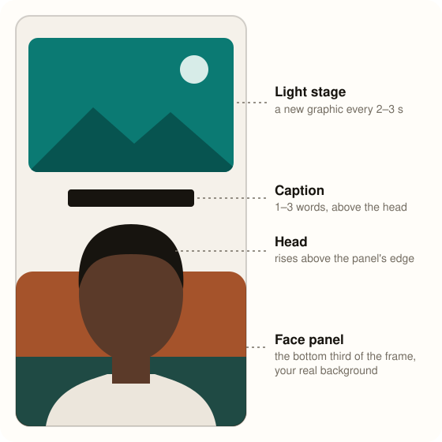

# video-edit

A skill for [Claude Code](https://claude.com/product/claude-code) that turns a raw talking-head recording, full of retakes, mistakes and long pauses, into a finished vertical reel for TikTok, Instagram Reels and YouTube Shorts.

Give Claude your video and it will:

- **Keep your best take of every line** and cut the mistakes, repeats and silences
- **Put you in a face panel** at the bottom of the frame, with your head rising above its edge onto a light stage
- **Add a new graphic every 2–3 seconds**, with real B-roll from your own videos and captions of 1–3 words
- **Add light sound effects** on every visible action, from a library of 76 original sounds
- **Render it** in Full HD or 2K, mixed to −14 LUFS, and check the sound is in sync

<p align="center"></p>

The panel fits itself to you. It measures your head in the footage and sets the zoom, so your head lands at the same size and height whether you filmed close up or further back.

## Install

### As a plugin (updates itself)

In Claude Code, run these two commands:

```text
/plugin marketplace add decwap/video-edit
/plugin install video-edit@decwap
```

In the Claude desktop app, open the **Code** tab, click **+** next to the prompt box, choose **Add plugins**, add the marketplace `decwap/video-edit`, then install **Video Edit**.

**Turn on auto-update** so you get every new version without doing anything: run `/plugin`, open **Marketplaces**, select **decwap**, then select **Enable auto-update**. Claude Code leaves auto-update off for marketplaces outside Anthropic's own until you turn it on. Without it, run `/plugin marketplace update decwap` to update.

### Or clone it into your skills folder

```bash
git clone https://github.com/decwap/video-edit ~/.claude/skills/video-edit
```

On Windows, in PowerShell:

```powershell
git clone https://github.com/decwap/video-edit "$HOME\.claude\skills\video-edit"
```

Then start a new Claude Code session. To update later, run `git pull` in that folder. Use one method, not both: if you switch to the plugin, delete this folder first so you don't load two copies.

**Using a Claude account across computers?** Download `video-edit.zip` from the [latest release](https://github.com/decwap/video-edit/releases/latest) and upload it at [claude.ai/customize/skills](https://claude.ai/customize/skills): **+**, then **+ Create skill**, then **Upload a skill**. The skill still runs on your own computer through Claude Code, because it needs your files and the tools below.

## What you need

Node.js 18+, Python 3.10+ and ffmpeg.

| System | Install |
| --- | --- |
| macOS | `brew install node ffmpeg python` |
| Windows | `winget install OpenJS.NodeJS.LTS Gyan.FFmpeg Python.Python.3.12` |
| Linux | `sudo apt install nodejs npm ffmpeg python3-pip` |

Then the Python packages:

```bash
python -m pip install numpy scipy pillow opencv-python
```

ffmpeg needs `zscale` for phone HDR footage and the `libvpx-vp9` decoder for the face panel. The Homebrew and gyan.dev builds have both. To check another build, run `ffmpeg -filters | grep zscale` and `ffmpeg -decoders | grep libvpx-vp9`.

**Stock clips are optional.** To let Claude search [Pexels](https://www.pexels.com), get a free key at [pexels.com/api](https://www.pexels.com/api/) and add it to your shell profile:

```bash
echo 'export PEXELS_API_KEY="your-key"' >> ~/.zshrc
```

Use `~/.bashrc` on most Linux systems. On Windows, run `setx PEXELS_API_KEY "your-key"` in PowerShell. Then restart Claude Code. Everything else works without a key.

The first run downloads the [HyperFrames](https://hyperframes.heygen.com) renderer, a headless browser, and the transcription and background-removal models. Transcription, the cutout and the render then run on your computer.

## Use it

Open Claude Code in the folder with your video and ask:

```text
Edit video.MP4 with /video-edit
```

If you installed the plugin, the command is `/video-edit:video-edit`. Type `/video-edit` and pick it from the list. It also starts on its own when you say something like "edit my raw footage" or "remove my repeated takes". Claude asks a few short questions, such as the keyword for your call to action and where your other videos are, shows you a storyboard, then renders `video (Edited).mp4` next to your original.

A few things to know:

- **Retakes are fine.** Say a line again when you get it wrong, and Claude keeps the last clean read.
- **Point it at your own footage.** Real clips of your product or past videos make a better reel than stock. When nothing real fits, it can search [Pexels](https://www.pexels.com) for free stock clips, once you've added the free key above.
- **Want the full-screen look instead?** Ask for full-frame beats, or for the old flat panel, and it will build those instead.
- **Cutouts take time.** The face panel cuts you out of every frame: about 0.2 seconds per frame on Apple silicon and about 1 second on CPU.

## What's inside

| Folder | What it holds |
| --- | --- |
| `SKILL.md` | The workflow Claude follows |
| `references/` | Style, motion, sound, take selection and pipeline guides |
| `scripts/` | Take selection, A-roll, the face panel, B-roll, the scene kit and render checks |
| `examples/` | A worked 75-second reel and a minimal face panel scene |
| `assets/` | Fonts, paper textures, sounds and icons |

## License

[MIT](LICENSE) for the code, docs, sounds and textures. The fonts keep their [SIL Open Font License](assets/fonts) and the Lucide icons keep their [ISC license](assets/icons-LICENSE.txt). HyperFrames is downloaded when the skill runs and has its own license. Stock clips come from Pexels under the [Pexels License](https://www.pexels.com/license/).

This is an independent project, not affiliated with Anthropic, HeyGen or Pexels.
